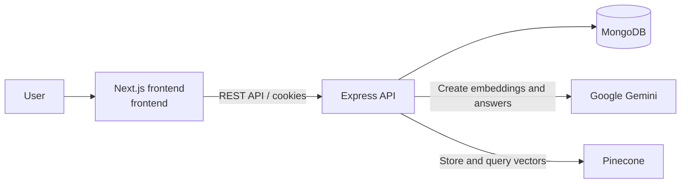

# Second Brain (Brain Dock)

[](https://github.com/Vishesh-Verma-07/SecondBrain/actions/workflows/ci.yml)
[](https://nextjs.org/)
[](https://nodejs.org/)
[](https://www.typescriptlang.org/)
[](https://opensource.org/license/isc-license-txt/)

Second Brain, presented in the product as **Brain Dock**, is a personal knowledge-management application for saving notes, links, and YouTube videos in one searchable workspace. It organises saved content with collections and tags, supports public share links, and uses AI-powered semantic search to return grounded answers from a user's own knowledge.

## Demo

Live deployment: [secondbrain.visheshxdevs.in](https://secondbrain.visheshxdevs.in)

## Features

- Account registration and sign-in with JWT-backed HTTP-only cookies
- Sign in / sign up with Google (OAuth 2.0, server-side code exchange)
- Save notes, links, and supported YouTube videos
- Organise saved items with collections and tags
- Browse, filter, sort, inspect, and delete saved content
- Create and revoke public links for an entire knowledge workspace
- Semantic search over personal content using vector embeddings
- AI-generated, context-aware summaries of relevant saved items
- Health-check endpoint for service monitoring

## Tech Stack

- **Frontend:** Next.js 16, React 19, TypeScript, Lucide
- **Backend:** Node.js, Express, TypeScript, Zod
- **Data:** MongoDB, Mongoose, Pinecone vector database
- **AI:** Google Gemini, LangChain
- **Authentication:** JSON Web Tokens, bcrypt, cookie-parser, Google OAuth 2.0
- **DevOps:** Docker, Docker Compose, Kubernetes, GitHub Actions
- **Code quality:** ESLint, Prettier

## Architecture



## Project Structure

```text
.
├── backend/                    # Express API and AI/search integrations
│   ├── src/
│   │   ├── controller/         # Request handlers
│   │   ├── db/                 # MongoDB connection
│   │   ├── middlewares/        # Authentication middleware
│   │   ├── models/             # Mongoose models
│   │   ├── routes/             # API routes
│   │   └── utility/            # Shared helpers and response utilities
│   ├── Dockerfile
│   └── package.json
├── frontend/                   # Next.js frontend
│   ├── src/app/                # Pages, layouts, and styles
│   ├── src/components/         # Reusable UI components
│   ├── src/lib/api.ts          # Frontend API client
│   ├── public/                 # Static assets
│   ├── Dockerfile
│   └── package.json
├── kubernetes/                 # Namespace, services, deployments, ingress
├── .github/workflows/ci.yml    # Continuous integration workflow
└── docker-compose.yml          # Local multi-container setup
```

> The active frontend is `frontend/`. The legacy Vite app and the intermediate `frontend-new/` directory have both been removed.

## Installation

### Prerequisites

- Node.js 20+
- npm
- MongoDB, or Docker for the Compose setup
- Google Gemini and Pinecone credentials for semantic search

Clone the repository and install dependencies for both services:

```bash
git clone https://github.com/Vishesh-Verma-07/SecondBrain.git
cd SecondBrain

cd backend
npm install

cd ../frontend
npm install
```

## Environment Variables

Create `backend/.env`:

```env
# Server
PORT=8080

# Database and authentication
MONGO_URI=mongodb+srv://<username>:<password>@<cluster>/<database>
JWT_SECRETE=replace-with-a-long-random-secret

# Google sign-in (Google Cloud Console → APIs & Services → Credentials)
GOOGLE_CLIENT_ID=your-client-id.apps.googleusercontent.com
GOOGLE_CLIENT_SECRET=your-client-secret
GOOGLE_CALLBACK_URL=http://localhost:8080/api/v1/user/google/callback
FRONTEND_URL=http://localhost:3000

# Google Gemini
GEMINI_API_KEY=your-gemini-api-key

# Pinecone vector search
PINECONE_API_KEY=your-pinecone-api-key
PINECONE_INDEX_NAME=your-index-name
PINECONE_URL=your-index-host-url
```

Create `frontend/.env`:

```env
NEXT_PUBLIC_API_URL=http://localhost:8080/api/v1
```

`NEXT_PUBLIC_API_URL` is embedded into the Next.js client at build time. Do not put secrets in frontend environment variables. The repository's existing backend environment also includes Google service-account variables; they are not used by the current application source.

## Google Sign-In Setup

Google sign-in uses the OAuth 2.0 authorization-code flow. The browser is redirected to Google, Google redirects back to the backend, the backend exchanges the code (using the client secret, which never reaches the browser), creates or links the user, sets the usual http-only session cookie, and then redirects to `/dashboard`.

1. Open [Google Cloud Console → Credentials](https://console.cloud.google.com/apis/credentials).
2. Configure the **OAuth consent screen** (External, app name, support email, developer email).
3. Click **Create credentials → OAuth client ID**, choose **Web application**.
4. Add **Authorized redirect URIs** — one per environment. They must match exactly, including scheme, host, port, and path:
   - Local: `http://localhost:8080/api/v1/user/google/callback`
   - Production: `https://<your-domain>/api/v1/user/google/callback`
5. Add **Authorized JavaScript origins** for the frontend host (not required by this server-side flow, but harmless): `http://localhost:3000`, `https://<your-domain>`.
6. Copy the client ID and client secret into `backend/.env`:

   ```env
   GOOGLE_CLIENT_ID=...apps.googleusercontent.com
   GOOGLE_CLIENT_SECRET=...
   GOOGLE_CALLBACK_URL=http://localhost:8080/api/v1/user/google/callback
   FRONTEND_URL=http://localhost:3000
   ```

7. Restart the backend. The **Continue with Google** button now appears on `/login` and `/signup`.

### Production notes

The current deployment runs the API on Render and the frontend on its own host, so the two are different sites. Pick **one** of the two layouts below; do not mix them, because the Google callback and the API requests must use the same host.

**Option A — call the Render API directly (zero repo changes)**

- `GOOGLE_CALLBACK_URL=https://<your-service>.onrender.com/api/v1/user/google/callback`
- `FRONTEND_URL=https://<your-frontend-domain>`
- Add `https://<your-service>.onrender.com/api/v1/user/google/callback` to Google Cloud Console → **Authorized redirect URIs**.
- Set `CORS_ORIGINS=https://<your-frontend-domain>` so credentialed requests are allowed.
- The session cookie is cross-site here. It works in Chrome and Firefox, but Safari's tracking prevention may drop it.

**Option B — proxy the API through the frontend domain (recommended)**

Everything stays on one site, which makes the session cookie first-party and avoids Safari issues.

- Set `API_PROXY_TARGET=https://<your-service>.onrender.com` (no trailing slash) and `NEXT_PUBLIC_API_URL=/api/v1` in the frontend's build environment, then redeploy. `next.config.ts` forwards `/api/*` to Render.
- `GOOGLE_CALLBACK_URL=https://<your-frontend-domain>/api/v1/user/google/callback`
- `FRONTEND_URL=https://<your-frontend-domain>`
- Add that same callback URL to Google Cloud Console → **Authorized redirect URIs**.
- No `CORS_ORIGINS` entry is needed, since requests are same-origin.

> **Symptom of a mismatched setup:** after choosing a Google account you land on a **404 "This page wandered off"** page at `/api/v1/user/google/callback?...`, and clicking **Go to dashboard** bounces you to `/login`. That means the callback URL points at the frontend host but `/api` is not being proxied to the backend, so the code exchange never happens. Fix it with Option A or Option B above.
>
> The callback also reports a coarse `reason` code on the login page. `reason=state` means the browser never sent the short-lived OAuth cookie back to the API — usually because the flow started on one host and the callback landed on another (mixed Option A/B configuration). The backend logs the request host and configured callback URL when this happens; check the Render logs.

Other requirements:

- Render sets `NODE_ENV=production` automatically at runtime. In that mode the session cookie is issued with `Secure; SameSite=None`, which requires HTTPS, and `JWT_SECRETE` must be present or the server refuses to start.
- Add `GOOGLE_CLIENT_ID`, `GOOGLE_CLIENT_SECRET`, `GOOGLE_CALLBACK_URL`, and `FRONTEND_URL` to the Render environment variables. `GOOGLE_CALLBACK_URL` and `FRONTEND_URL` can also live in `kubernetes/backend/config.yml` for the Kubernetes manifests, which use the ingress domain instead of Render.
- Accounts created with Google have no password. Signing in with a password for such an account returns a message pointing the user to Google. Existing password accounts are linked automatically the first time the user signs in with the same verified Google email.

## Usage

Run the API and frontend in separate terminals:

```bash
# Terminal 1
cd backend
npm run dev

# Terminal 2
cd frontend
npm run dev
```

Open `http://localhost:3000`. The API is available at `http://localhost:8080/api/v1`.

### Docker Compose

Docker Compose starts the active frontend, backend, and a MongoDB container:

```bash
docker compose up --build
```

The frontend is exposed at `http://localhost:3000`, the API at `http://localhost:8080`, and MongoDB at `localhost:27017`.

## Automation

GitHub Actions runs on pushes and pull requests to `main`. It installs dependencies, lints, and builds both `backend/` and `frontend/` using Node.js 20.

## Example Output

Check API availability with:

```bash
curl http://localhost:8080/api/v1/health
```

Example response:

```json
{
  "statusCode": 200,
  "data": {
    "status": "ok",
    "message": "Health check successful"
  }
}
```

## Configuration

- **Frontend API URL:** Set `NEXT_PUBLIC_API_URL` in `frontend/.env`.
- **Backend port:** Set `PORT` in `backend/.env`; Docker Compose uses port `8080`.
- **Allowed origins:** Update the `allowedOrigins` list in `backend/src/index.ts` when deploying the frontend to another domain.
- **Deployment manifests:** Kubernetes configuration is in `kubernetes/`, with ingress routing `/api` to the backend and all other traffic to the frontend.

## APIs & External Services

- [MongoDB](https://www.mongodb.com/) for persistent application data
- [Google Gemini](https://ai.google.dev/) for embeddings and generated search summaries
- [Pinecone](https://www.pinecone.io/) for vector storage and semantic retrieval
- [YouTube](https://www.youtube.com/) for embeddable video links

## Roadmap

- [ ] Add unit and integration tests for API routes and controllers
- [ ] Publish OpenAPI documentation
- [ ] Add configurable CORS origins and application port handling
- [ ] Keep Pinecone vectors synchronized when content is updated or deleted
- [ ] Add collection-level and item-level sharing
- [ ] Add rate limiting and structured application logging

## Contributing

Fork the repository, create a focused branch, make and test your change, then open a pull request that explains the problem and solution. Keep changes scoped and ensure both applications pass their lint and build checks.

## License

This project is licensed under the [ISC License](https://opensource.org/license/isc-license-txt/).

## Author

**Vishesh Verma** - Owner and author

## Acknowledgements

Built with Next.js, Express, MongoDB, Mongoose, LangChain, Google Gemini, Pinecone, Docker, and Kubernetes.
